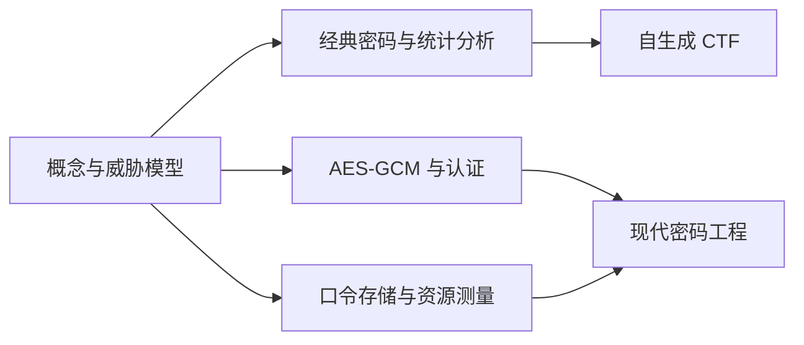

# CryptoSec-Lab

**Cryptography & Password Security Learning Lab · 密码学与口令安全实验室**

[](pyproject.toml)
[](LICENSE)

[English](README_EN.md) · [学习导航](docs/index.md) · [项目规划](PROJECT_PLAN.md) · [12 周路线](docs/ROADMAP.md) · [参与贡献](CONTRIBUTING.md)

用可运行的 Python 实验理解密码学：观察经典密码的统计弱点，验证现代认证加密的篡改检测，测量口令派生函数的时间和内存开销。中文为主，关键入口提供英文。面向初学者、网络安全学生和希望复核工程细节的开发者。

## 当前可用

| 实验 | 内容 | 指南 |
| --- | --- | --- |
| Caesar | 大小写字母加解密、26 个候选、英语卡方频率排名、交互式移位图 | [经典密码](docs/classical/caesar.md) |
| AES-GCM | AES-256、随机 96 位 nonce、AAD、密文被改后的认证失败 | [现代密码工程](docs/modern/aes-gcm.md) |
| Password KDF | Argon2id、scrypt、PBKDF2 加盐验证，独立进程测量 | [口令哈希](docs/passwords/kdf.md) |

这些是教学 API，尚未包含生产密钥管理、网络服务或真实账户测试功能。

## 快速开始

需要 Python 3.11+。从仓库根目录执行：

```powershell
# Windows PowerShell：无需激活环境
py -3.12 -m venv .venv
.\.venv\Scripts\python.exe -m pip install -e ".[dev]"
.\.venv\Scripts\cryptosec.exe caesar
.\.venv\Scripts\cryptosec.exe aes
.\.venv\Scripts\cryptosec.exe kdf --repeats 3
.\.venv\Scripts\python.exe -m pytest -q
.\.venv\Scripts\python.exe -m ruff check .
.\.venv\Scripts\python.exe -m ruff format --check .
```

如果只有其他受支持版本，将 `py -3.12` 改成对应版本。Linux/macOS：

```bash
python3 -m venv .venv
.venv/bin/python -m pip install -e '.[dev]'
.venv/bin/cryptosec caesar
.venv/bin/cryptosec aes
.venv/bin/cryptosec kdf --repeats 3
.venv/bin/python -m pytest -q
.venv/bin/python -m ruff check .
.venv/bin/python -m ruff format --check .
```

需要复现本次依赖时，先用同一虚拟环境的 Python 执行 `-m pip install -r requirements-dev.lock`，再执行 `-m pip install --no-deps --no-build-isolation -e .`。锁文件记录已验证的精确版本；Python 版本和操作系统也会影响结果。

## 一个最小示例

```python
from cryptosec_lab.modern import decrypt, encrypt, new_key

key = new_key()  # 每次运行动态生成；不要写入仓库或日志
envelope = encrypt(key, b"CryptoSec-Lab", b"lesson:01")
assert decrypt(key, envelope, b"lesson:01") == b"CryptoSec-Lab"
```

运行 `cryptosec aes` 的稳定输出：

```json
{
  "roundtrip": true,
  "tamper_rejected": true,
  "nonce_bytes": 12
}
```

KDF 演示只生成合成口令，不接受外部口令文件、凭据或目标地址。每种算法最多 5 次哈希和验证，单个子进程超时 60 秒，串行执行。参数固定，Argon2id 使用 64 MiB 内存；详细测量边界见指南。

## 学习路线与进度

| 模块 | 学习目标 | 状态 |
| --- | --- | --- |
| 01 Fundamentals | 编码/加密/哈希/MAC/签名、AES/RSA/ECC、nonce/IV | 已有概念入口；专题待实现 |
| 02 Classical Cryptography | Caesar → Vigenère/替换/仿射/置换/频率分析 | Caesar 已实现，其余已规划 |
| 03 Hash & Password Security | MD5/SHA 家族、盐、bcrypt、scrypt、Argon2id、彩虹表 | 三种 KDF 已实现，其他已规划 |
| 04 Password Security Laboratory | 合成数据、熵局限、基准、小规模离线风险、MFA | 有界 KDF 基准已实现，其余已规划 |
| 05 CTF Crypto Challenges | 自生成题、提示、数学解释、参考答案、测试 | 已规划 |
| 06 Modern Cryptography Engineering | AEAD、OAEP/PSS、ECDH/HKDF、签名、密钥管理 | AES-GCM 已实现，其余已规划 |



双击 [交互式 Caesar 演示](assets/caesar.html) 在浏览器中运行，无网络请求。GitHub 文件页显示源码，需下载后打开。仓库采用 `src/cryptosec_lab` 可导入包，文档按主题组织，测试放在 `tests/`。

## 更新与社区

当前版本为 **0.1.0 本地发布候选**；尚未创建远程 Release。后续计划按 v0.2 经典密码、v0.3 哈希实验、v0.4 CTF、v0.5 工程实践推进，见 [Roadmap](docs/ROADMAP.md) 和 [Release Notes](docs/releases/v0.1.0.md)。

欢迎贡献可复现的错误报告、文档澄清、测试和实验。[贡献指南](CONTRIBUTING.md) 规定验收方法，[社区配置](docs/COMMUNITY.md) 提供 Topics、Discussions 和首批 Issue 建议。只展示可验证的内容和结果，欢迎基于实际使用反馈参与。

## 许可与安全

代码与原创文档使用 [MIT](LICENSE) 许可。实验仅用于自建环境、合成数据、CTF 或明确授权的对象。禁止用于未授权访问、凭据收集或认证绕过。安全问题报告流程见 [SECURITY.md](SECURITY.md)。所有实验输出和首次验证记录见 [PROGRESS.md](PROGRESS.md)。
